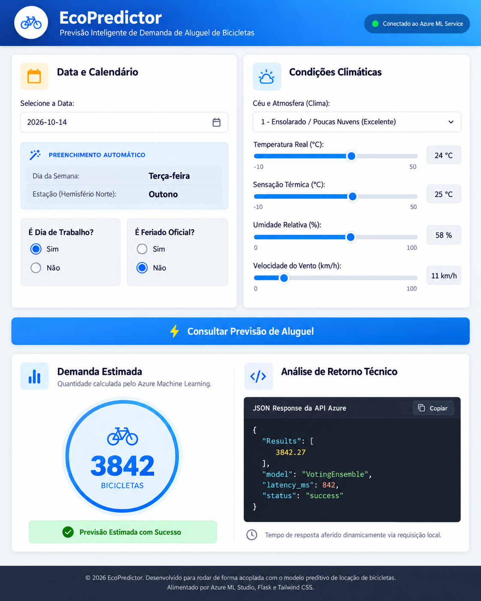
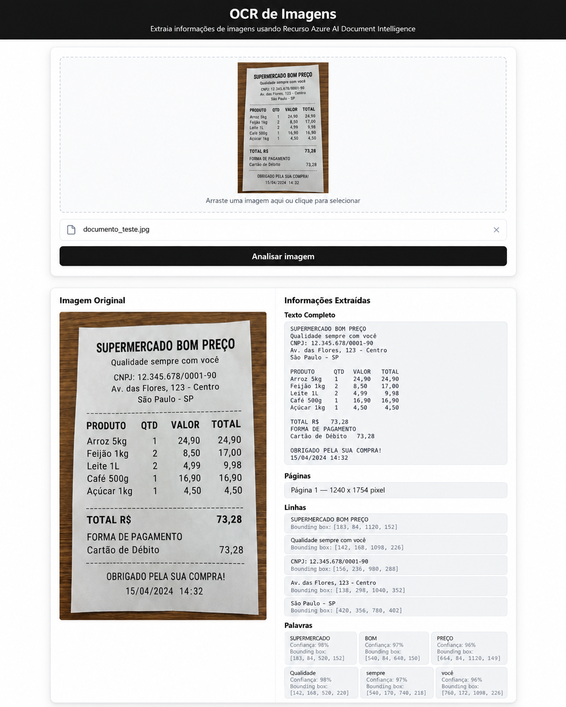
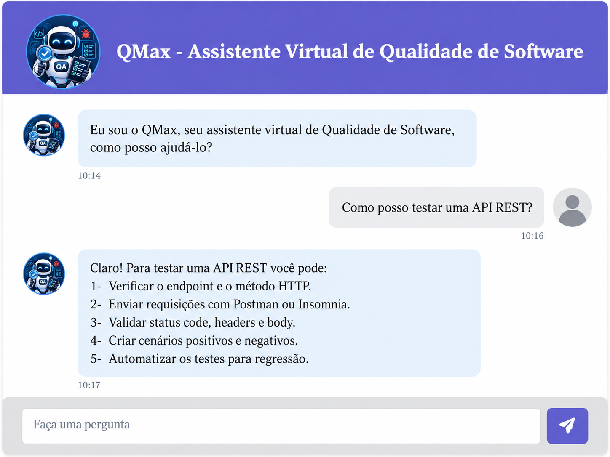

# AI-901 | Projetos desenvolvidos no SENAI

Repositório de estudos e aplicações práticas realizadas durante o curso **AI-901**, com foco em Inteligência Artificial aplicada ao Microsoft Azure, no SENAI.

O objetivo deste repositório é documentar minha evolução, o uso de serviços de IA na nuvem, a arquitetura de integração e os aprendizados ao transformar exercícios de laboratório em aplicações web.

> **Transparência:** os exemplos funcionam localmente com `APP_MODE=demo`, um modo de **simulação claramente identificado**. As imagens abaixo são *mockups ilustrativos* — **não comprovam execução no Azure**. Para demonstrar resultados reais, siga os READMEs de cada aplicação e registre evidências próprias de testes.

## Aplicações

| Projeto | Problema e solução | Tecnologias | Serviço Azure |
|:--|:--|:--|:--|
| [01 · EcoPredictor](projetos/01-ecopredictor/) | Estimar demanda de aluguel de bicicletas com variáveis meteorológicas e de calendário | Python, Flask, HTML, Tailwind CSS e JavaScript | Azure Machine Learning (AutoML / regressão) |
| [02 · OCR](projetos/02-ocr-document-intelligence/) | Extrair texto de imagens, linhas, palavras e confiança | Python, Flask, HTML, CSS e JavaScript | Azure AI Document Intelligence (`prebuilt-read`) |
| [03 · QMax](projetos/03-qmax-assistente-qa/) | Assistente conversacional especializado em Qualidade de Software | Node.js, Express, JavaScript, HTML e CSS | Azure OpenAI / Microsoft Foundry |

### 01 · EcoPredictor



Aplicação de regressão; no experimento de estudo foi usado AutoML para comparar modelos. Em uma sessão posterior, o Azure ML apresentou `VotingEnsemble` como melhor algoritmo, mas **os valores da imagem são ilustrativos**. Para métricas ou números oficiais, utilizar resultados exportados do trabalho real.

### 02 · OCR de Imagens



Aplicação que envia imagens ao modelo pré-treinado `prebuilt-read` para obter conteúdo textual e informações estruturadas. O modo demonstração não executa OCR real.

### 03 · QMax — Assistente Virtual de QA



Chatbot orientado por instruções de sistema, restrito ao tema Qualidade de Software. O código foi reorganizado com backend Express para não expor a credencial Azure OpenAI no navegador.

## O que aprendi e apliquei

- **Machine Learning supervisionado:** regressão, conjunto de dados, variável-alvo, execução do AutoML, avaliação de experimentos, registro de modelo e endpoints de inferência.
- **Visão computacional aplicada:** reconhecimento óptico de caracteres, extração estruturada de texto e interpretação de retorno JSON.
- **IA generativa:** implantação/consumo de LLM, instruções de sistema, prompts orientados a domínio e integração com chatbot.
- **Integração de software:** APIs HTTP/REST, consumo de serviços Azure por backends Python/Node.js e tratamento de falhas.
- **Engenharia e segurança:** separação de credenciais, variáveis de ambiente, validação de entrada, renderização segura, modos de demonstração e documentação reproduzível.

## Como executar

Os projetos são independentes. Acesse o README de cada pasta para instalar dependências e iniciar. Todos rodam com dados simulados **sem assinatura Azure** em `APP_MODE=demo`. Para usar os serviços reais, obtenha recursos e credenciais válidas no Azure e ajuste o `.env` correspondente, sem colocá-lo no Git.

| Aplicação | Endereço local padrão |
|---|---|
| EcoPredictor | `http://127.0.0.1:5000` |
| OCR | `http://127.0.0.1:5001` |
| QMax | `http://127.0.0.1:3000` |

## Evidências, custos e ética

- Imagens em [`docs/mockups`](docs/mockups/) são **ilustrativas**.
- Capturas verdadeiras de implantação/inferência devem ser registradas separadamente conforme [`docs/evidencias/README.md`](docs/evidencias/README.md).
- Os serviços Azure podem cobrar por uso. Um endpoint online pode gerar custos mesmo ocioso; revise e exclua recursos após os testes.
- Nunca publique prints contendo chaves, documentos reais de clientes ou identificadores privados de assinatura.
- Não compartilhe trechos do Azure Portal institucional que indiquem acesso ou autorização não confirmados.

## Organização

```text
ai901-senai-projetos/
├── projetos/
│   ├── 01-ecopredictor/
│   ├── 02-ocr-document-intelligence/
│   └── 03-qmax-assistente-qa/
├── docs/
│   ├── arquitetura.md
│   ├── mockups/               
│   └── evidencias/             
├── scripts/check_secrets.py
├── tests/
├── SECURITY.md
├── .gitignore
└── README.md
```

**Segurança:** leia [`SECURITY.md`](SECURITY.md). Os arquivos originais continham chaves reais, por isso é necessário **revogar/rotacionar essas chaves no Azure**; o novo repositório não contém essas credenciais.

> Projeto educacional independente, sem vínculo oficial com a Microsoft ou com o SENAI. Os nomes das marcas são utilizados para identificar as tecnologias estudadas.
