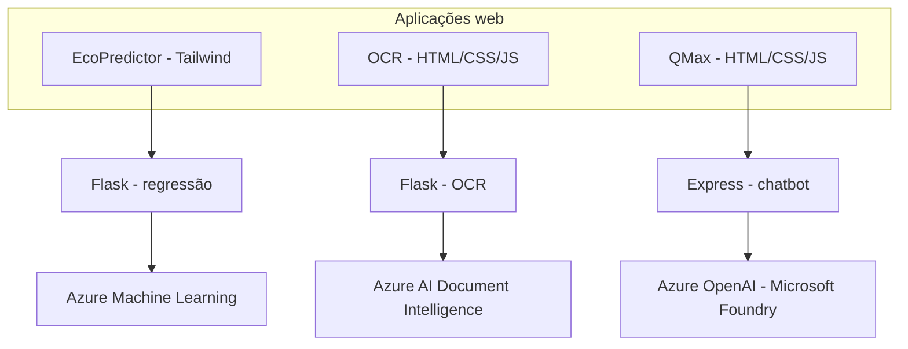

# Arquitetura geral

As três aplicações têm modo `APP_MODE=demo` por padrão. Nele, **os exemplos são simulados** e não fazem requisições ao Azure. Para chamadas verdadeiras, configure `APP_MODE=azure` e credenciais locais no respectivo `.env`. Nunca versionar tokens ou arquivos de configuração real.
