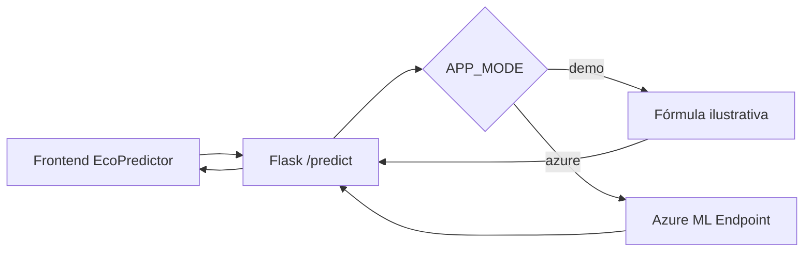

# EcoPredictor — Previsão de aluguel de bicicletas

Aplicação Flask do curso AI-901 com frontend **original** (HTML, Tailwind CSS e JavaScript) e integração opcional ao Azure Machine Learning.

## Executar no Windows

```powershell
py -m venv .venv
.\.venv\Scripts\Activate.ps1
pip install -r requirements.txt
Copy-Item .env.example .env
py app.py
```

Acesse `http://127.0.0.1:5000`.

**Modo `demo` (padrão):** exibe resultado de uma fórmula ilustrativa; **não** é previsão de um modelo de IA. O frontend indica que está em demonstração.

**Modo `azure`:** edite o `.env` local com `APP_MODE=azure`, `AZURE_ML_ENDPOINT`, `AZURE_ML_KEY` e, se necessário, `AZURE_ML_DEPLOYMENT` conforme a aba **Consumir** do endpoint online real. A chave nunca é enviada ao navegador. O backend utiliza HTTPS com validação normal de certificado.

> O JSON de entrada foi preservado do projeto original (`input_data.columns/index/data`). Se o novo endpoint MLflow exigir outro contrato, consulte o exemplo de consumo gerado pelo Azure e ajuste `call_azure()` antes de utilizar em produção.

## Entradas do modelo

`dia`, `mes`, `ano`, `estacao`, `feriado`, `dia_semana`, `dia_util`, `situacao_climatica`, `temperatura`, `sensacao_termica`, `umidade`, `velocidade_vento`.

O código mantém a normalização original do formulário para temperatura, umidade e vento. O histórico UCI Bike Sharing usado no experimento vai de 2011 a 2012; previsões para anos muito posteriores são extrapolação e requerem avaliação adicional.

## API

`POST /predict` com `application/x-www-form-urlencoded` e as 12 entradas; resultado: `{"Results": [valor], "demo": true|false}`.

## Arquitetura



**Custos:** endpoints online do Azure ML podem gerar cobrança mesmo ociosos; exclua recursos de inferência ao terminar os testes.
