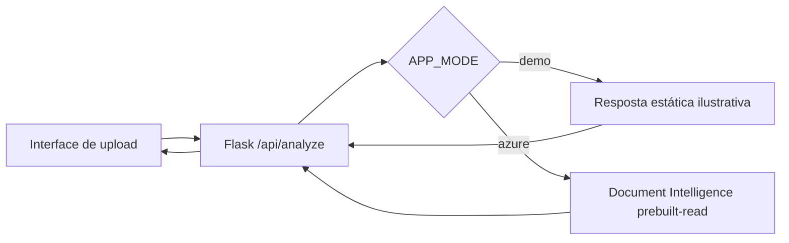

# OCR — Azure Document Intelligence

Aplicação Flask com upload de imagens e extração estruturada de texto via modelo pré-treinado `prebuilt-read`. HTML e CSS originais foram preservados.

## Executar

```powershell
py -m venv .venv
.\.venv\Scripts\Activate.ps1
pip install -r requirements.txt
Copy-Item .env.example .env
py app.py
```

Abra `http://127.0.0.1:5001` e envie `exemplos/documento_demo.png`.

Por padrão, `APP_MODE=demo` mostra texto fixo e uma indicação visível de **simulação**, sem enviar a imagem ao Azure. Isso não valida a acurácia do OCR. Para uma execução real, configure `APP_MODE=azure`, `AZURE_DOCUMENT_INTELLIGENCE_ENDPOINT` e `AZURE_DOCUMENT_INTELLIGENCE_KEY` no arquivo `.env` local.

Endpoint: `POST /api/analyze` (multipart form, campo `image`). A API devolve `content`, `pages`, `lines`, `words` e `confidence`. Limite padrão 4 MB (nível F0), ajustável por `MAX_UPLOAD_MB` respeitando a cota do serviço.

## Arquitetura



A aplicação utiliza validação de imagem com Pillow, não salva arquivos enviados no disco e escapa textos extraídos na renderização HTML para reduzir risco de XSS. Use somente documentos sem informações pessoais ao capturar evidências públicas.
