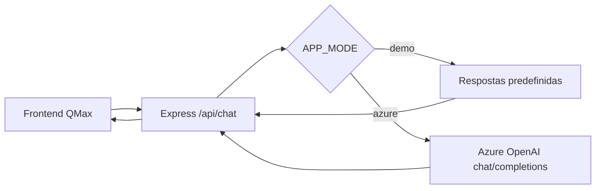

# QMax — Assistente Virtual de Qualidade de Software

Frontend **original** em HTML, CSS e JavaScript (incluindo as imagens `bot.png` e `enviar.png`) e um novo backend Express para proteger a chave Azure OpenAI.

## Executar

Pré-requisito: Node.js 18+.

```powershell
npm install
Copy-Item .env.example .env
npm start
```

Acesse `http://127.0.0.1:3000`. Em `APP_MODE=demo`, o chat usa respostas predefinidas rotuladas como **DEMONSTRAÇÃO**. **Não existe LLM local nem Azure nessa modalidade.**

Para consumir o serviço real, configure no `.env` do backend:

```dotenv
APP_MODE=azure
AZURE_OPENAI_BASE_URL=https://SEU-RECURSO.openai.azure.com/openai/v1
AZURE_OPENAI_KEY=SUA_CHAVE_PRIVADA
AZURE_OPENAI_DEPLOYMENT=SEU_DEPLOYMENT
```

O frontend faz `POST /api/chat` no Express; o servidor chama `POST {AZURE_OPENAI_BASE_URL}/chat/completions`. O identificador em `model` é o **nome do deployment** criado no Azure, não necessariamente o nome comercial do modelo.

O projeto original incluía uma chave do Azure dentro do JavaScript público. **Não reutilize essa chave: revogue/regenere no Azure.** O código atual usa variáveis de ambiente no servidor e `textContent` para proteger a renderização de respostas.

## Arquitetura



**Antes de publicar a aplicação na Internet:** acrescentar autenticação, rate limiting, orçamento/quotas, controle de abuso e observabilidade. O exemplo entregue aqui está preparado para **execução local e estudos**.
